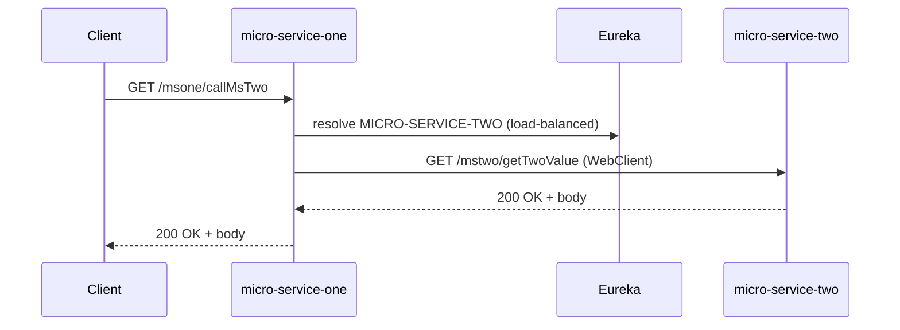

# micro-service-one — High Level Design (HLD)

Status: Draft

Date: 2026-10-19

Purpose
- Provide a concise, implementation-verified high-level design for `micro-service-one` (code: `src/main/java/com/ismail/msone`).
- Document runtime interactions, REST contract, event usage, failure modes, security and monitoring recommendations.

Scope
- This document is limited to the `micro-service-one` codebase in this repository and verified configuration under `src/main/resources/application.yaml`.
- It does not propose breaking changes; suggestions are labeled as "Recommendation".

Sources checked
- `ControllerOne.java` — exposes REST endpoints and performs an outbound WebClient call to `MICRO-SERVICE-TWO`.
- `WebClientConfig.java` — provides a `@LoadBalanced` `WebClient.Builder`.
- `application.yaml` — server port and Eureka client configuration.

Summary / Overview
- `micro-service-one` is a Spring Boot application (reactive WebClient usage) that:
  - Exposes two HTTP endpoints under `/msone`:
    - `GET /msone/getOneValue` — returns a simple text response including configured `server.port`.
    - `GET /msone/callMsTwo` — forwards an HTTP GET to `MICRO-SERVICE-TWO` at `/mstwo/getTwoValue` using a load-balanced `WebClient` and returns the remote body as `Mono<String>`.
  - Registers with Eureka (configured defaultZone: `http://localhost:8761/eureka/`).
  - Uses a load-balanced `WebClient` (service id `MICRO-SERVICE-TWO`) for service-to-service calls.
  - There are no Kafka producers/consumers, no database, and no persistence in the current code.

Architecture diagram

Mermaid sequence diagram (runtime happy path):

REST Endpoints (observed)
- Base path: `/msone` (class-level `@RequestMapping("/msone")`).

- GET /msone/getOneValue
  - Response: text/plain (String)
  - Behavior: Returns a string: `Handled by MICRO-SERVICE-ONE on port <port>` where `<port>` is `server.port` from configuration.

- GET /msone/callMsTwo
  - Response: application/json or text depending on downstream — the controller returns `Mono<String>` from `WebClient`.
  - Behavior: Calls downstream service by service id `MICRO-SERVICE-TWO` at `/mstwo/getTwoValue` using a `@LoadBalanced` `WebClient.Builder`.
  - Non-blocking reactive type: returns `Mono<String>`.

Inter-service communications
- Service discovery: Eureka client configured (see `application.yaml`). The `WebClient` is annotated `@LoadBalanced` so DNS/service-id resolution + client-side load balancing is used.
- No circuit-breaker, retry or fallback is present in code. Calls are direct WebClient GET requests with default timeouts.

Kafka / Events
- There are no Kafka producers or consumers in this service (no classes matching `*Kafka*.java` were found). Therefore:
  - There are no outbound events emitted by `micro-service-one` at present.
  - There are no inbound event consumers.

Failure handling (current behavior and recommended improvements)
- Current (from code):
  - Outbound call uses `WebClient` without explicit timeout, retry or circuit-breaker. On downstream failure the returned `Mono` will propagate the error to the caller.
  - There is no centralized exception handler (`@ControllerAdvice`) observed.

- Recommendations:
  1. Add timeouts on WebClient exchanges to avoid unbounded waits. Example: configure `WebClient` with a per-request timeout or use Reactor `timeout(Duration)` on the `Mono`.
  2. Add retries with backoff for transient errors, but carefully — avoid retrying non-idempotent operations.
  3. Add a circuit-breaker (Resilience4j or Spring Cloud Circuit Breaker) around remote calls to fail fast when downstream is unhealthy.
  4. Provide fallbacks for `callMsTwo` using either a cached response or a meaningful error message.
  5. Implement a global `@ControllerAdvice` to translate exceptions into consistent HTTP error responses with structured JSON that includes an error code, message and correlation id.
  6. Handle thread/context propagation for reactive context (MDC/correlation ids). Use Reactor `Context` and an MDC bridge to keep correlation id in logs.

Security
- Current (from repo):
  - No Spring Security configuration files or annotations were found; the service appears to be unsecured by default.

- Requirements / Recommendations:
  1. Authenticate and authorize inbound requests (e.g., OAuth2/OIDC with JWT tokens) if the service is not behind a trusted API gateway.
  2. Enforce TLS between clients and the service in production (Ingress/Load Balancer termination is acceptable, but ensure internal traffic uses mTLS if required by policy).
  3. Validate and sanitize any user input (not applicable to current endpoints but important for future features).
  4. Propagate and validate authorization context to downstream services if calls require identity information.

Observability & Monitoring
- Logging
  - Use SLF4J with structured logging (JSON) in production. Ensure logs do not include secrets (never log environment variables/credentials).
  - Ensure a correlation ID is present for each request and propagated to logs (e.g., header `X-Correlation-ID`). Add a filter to create/propagate the header and populate MDC.

- Metrics
  - Expose Prometheus-compatible metrics via Micrometer (Spring Boot Actuator + Micrometer). Ensure endpoints:
    - `/actuator/health` (with relevant checks)
    - `/actuator/prometheus` (or metrics endpoint proxy)
  - Record custom timers/counters for: request latencies, outbound call latencies to `MICRO-SERVICE-TWO`, error rates, retries, and circuit-breaker state.

- Tracing
  - Add distributed tracing (OpenTelemetry/Jaeger/Zipkin) to trace the `callMsTwo` flow and correlate spans with logs.

- Alerts
  - Alert on: high error rate, elevated latencies, downstream circuit open, service instance deregistration from Eureka, and health-check failures.

Operational considerations
- Health checks
  - Expose and implement liveness and readiness endpoints (Actuator `health` and custom readiness that verifies downstream dependencies if appropriate).

- Startup & config
  - Service name: `micro-service-one` (from `spring.application.name` in `application.yaml`).
  - Port: configured to `8085` in `application.yaml`.
  - Eureka defaultZone points to `http://localhost:8761/eureka/` (local dev). In production, use the environment-specific discovery endpoints.

Testing
- Unit tests should cover controllers, reactive flows, and any added resiliency logic (mocks for WebClient). Use `StepVerifier` for Reactor types.
- Integration tests: run with a lightweight instance of `mstwo` (or mock server) and a test Eureka server, or use Testcontainers to run dependent services.

Open questions / Assumptions
- The downstream service id used by `WebClient` is `MICRO-SERVICE-TWO`. Confirm the exact service id and downstream endpoint contract with the `mstwo` repository.
- No security is configured; confirm whether an API gateway enforces auth in front of the service. If not, apply Spring Security.
- No Kafka or database usage is present; confirm if events or persistence are planned for future iterations.

Recommended immediate changes (minimal, non-breaking)
1. Add an Actuator dependency and enable `health`, `info`, `metrics` and `prometheus` endpoints.
2. Add a small `@ControllerAdvice` to convert errors to structured JSON with correlation id.
3. Add a timeout and basic circuit-breaker around the `WebClient` call to `MICRO-SERVICE-TWO`.
4. Add a simple request filter to generate/propagate `X-Correlation-ID` and attach it to Reactor context / MDC.

Appendix: quick code pointers (where to change)
- `ControllerOne.java` — current endpoints and `WebClient` usage.
- `WebClientConfig.java` — `@LoadBalanced` `WebClient.Builder` (augment here with default filters/timeouts if desired).
- `application.yaml` — service name, port and Eureka configuration.

Version history
- Draft created 2026-10-19 by documentation automation.
